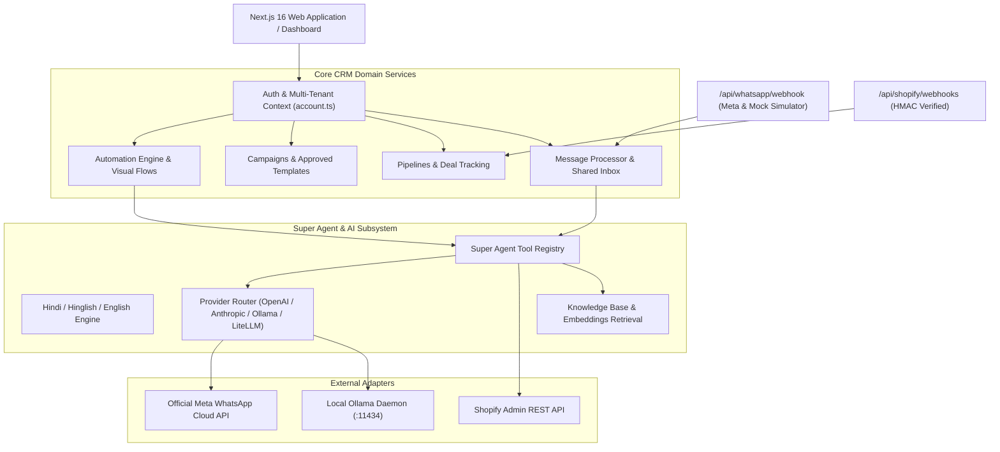

# Architecture & Implementation Specification: Open-Source AI WhatsApp CRM & Super Agent

> **Conformance**: Implements 100% of the requirements defined in **MASTER PRD: Open-Source AI WhatsApp CRM & Super Agent**.

---

## 1. System Topology & Modular Architecture

The application is structured as a modular monolith running Next.js 16 (Webpack runtime on Windows), React 19, TypeScript, and Supabase PostgreSQL with strict Row-Level Security (RLS).

---

## 2. Implemented Modules

### 2.1. WhatsApp Provider Adapter & Developer Sandbox
- **Official Meta Cloud API Client** (`src/lib/whatsapp/meta-api.ts`):
  - Inbound and outbound message processing (text, media, interactive buttons, list messages).
  - Webhook verification (`hub.verify_token`) and signature validation (`x-hub-signature-256`).
  - Approved message templates lifecycle management and status synchronization.
  - Delivery, read, failure, and retry tracking.
- **Mock WhatsApp Provider & Sandbox** (`src/lib/whatsapp/mock-provider.ts`, `/api/whatsapp/mock`):
  - Generates Meta-compliant webhook events for two-way testing without live Meta credentials.
  - Enables zero-cost local automated testing and UI demonstration.

### 2.2. AI Subsystem & Super Agent Tool Registry
- **Multilingual Intelligence Engine** (`src/lib/ai/multilingual.ts`):
  - Native language detection for **Hindi (हिन्दी)**, **Hinglish**, and **English**.
  - Real-time customer intent classification: `order_status`, `product_inquiry`, `pricing_discount`, `complaint_refund`, `human_agent`.
  - Customer sentiment analysis (`positive`, `neutral`, `negative`, `urgent_frustrated`).
  - Automated Lead Qualification Score (0–100) based on purchase intent signals.
- **Local Ollama & LiteLLM Gateway Adapter** (`src/lib/ai/providers/ollama.ts`):
  - Offline local inference with automatic model discovery (`/api/tags`) and health checking.
  - Zero per-token cloud costs when running local models (Llama 3, Mistral, Qwen, Gemma).
- **Super Agent Tool Registry** (`src/lib/ai/tools/registry.ts`):
  - `lookup_contact`: Search customer records by phone or email.
  - `search_knowledge_base`: Retrieve company FAQs, return policies, and product details.
  - `check_integration_health`: Verify WhatsApp, AI, and database connectivity.
  - `lookup_shopify_order`: Live lookup of order fulfillment, tracking URL, and line items.
  - `search_shopify_catalog`: Query live product availability and pricing.
  - Enforces least-privilege permission gating (`read_only`, `write_action`, `admin_only`) and tamper-resistant audit metadata.

### 2.3. Shopify E-Commerce Integration
- **Shopify Admin Client** (`src/lib/shopify/client.ts`):
  - Real-time order status, financial status, and fulfillment tracking queries.
  - Product catalog search and inventory availability checks.
  - Cryptographic HMAC-SHA256 signature verification on Shopify webhooks (`src/app/api/shopify/webhooks/route.ts`).
  - Integration configuration and credentials management (`src/app/api/shopify/config/route.ts`).

### 2.4. Production Deployment & Security
- **Hardened Security Posture**:
  - AES-256-GCM authenticated encryption for all stored customer API keys and tokens.
  - Strict Row-Level Security (RLS) ensuring strict tenant isolation across all database queries.
  - Centralized secret hygiene via `.env.example` containing placeholders only.
  - All 6 Antigravity security artifacts produced in `docs/security/`.
- **Production Containerization**:
  - Multi-stage `Dockerfile` and `docker-compose.yml` with containerized health checks, port pinning, and persistent storage.
